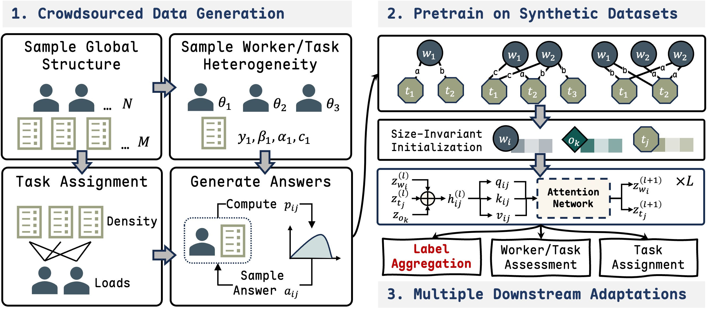

# CrowdFM

### Towards a Foundation Model for Crowdsourced Label Aggregation

**ICLR 2026** · [Paper](https://openreview.net/pdf?id=FF9QVQduAu) · [Code](https://github.com/liiuhaao/CrowdFM)



CrowdFM is a foundation model for crowdsourced label aggregation. It is pretrained once on domain-randomized synthetic crowdsourcing data and applied to unseen real-world datasets without dataset-specific retraining.

## Installation

```bash
pip install -e .
```

## Training

```bash
python train.py --task classification --device cuda:0 \
  --iterations 10000000 --batch-size 256 --backup
```

## Evaluation

```bash
python evaluate.py --task classification --device cuda:0 \
  --checkpoint checkpoints/classification/published.pt \
  --data data/classification --output log/evaluation.json
```

## Citation

```bibtex
@inproceedings{liu2026crowdfm,
  title     = {Towards a Foundation Model for Crowdsourced Label Aggregation},
  author    = {Liu, Hao and Liu, Jiacheng and Tang, Feilong and Chen, Long and Yu, Jiadi and Zhu, Yanmin and Dong, Qiwen and Yu, Yichuan and Hou, Xiaofeng},
  booktitle = {International Conference on Learning Representations (ICLR)},
  year      = {2026}
}
```
